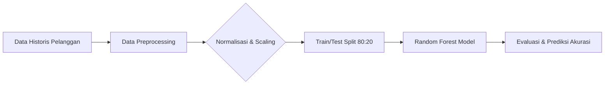

<div align="center">

<h1>🛒 Customer Churn Prediction & Retention System</h1>

<h3>Analisis Perilaku Pelanggan & Prediksi Risiko Churn Berbasis Machine Learning</h3>

*Dari data historis pelanggan ➔ prediksi risiko churn ➔ rekomendasi retensi otomatis.*

<br>

<!-- BAGIAN LOGO / BADGES -->


<br><br>

<!-- MENU NAVIGASI -->
<a href="#-studi-kasus">📖 Studi Kasus</a> • 
<a href="#-piramida-analitik">🔺 Piramida Analitik</a> • 
<a href="#-arsitektur--alur-kerja-crisp-dm">🏗️ Arsitektur</a> • 
<a href="#-cara-menjalankan">🚀 Cara Menjalankan</a> • 
<a href="#-contoh-output">📊 Contoh Output</a>

</div>

<br>

## 📖 Studi Kasus

Proyek ini diinspirasi oleh materi perkuliahan **Informatics Practitioner Lecture Series** mengenai penerapan *Machine Learning* di industri nyata.

**Konteks Masalah:**
Dalam bisnis *e-commerce*, tingginya angka pembeli yang meninggalkan keranjang belanja (*cart abandonment*) dan berhenti menggunakan layanan (*customer churn*) menjadi tantangan besar. Seringkali, manajemen mengambil tindakan secara reaktif setelah pelanggan benar-benar pergi, tanpa deteksi dini yang terukur terhadap kebiasaan transaksi pengguna.

**Tujuan Solusi:**
Membangun model **Supervised Learning (Klasifikasi)** menggunakan algoritma *Random Forest* untuk memprediksi probabilitas pelanggan yang berisiko tinggi melakukan *churn*. Hasil prediksi ini memungkinkan tim pemasaran untuk meluncurkan kampanye retensi otomatis dan diskon khusus secara proaktif.

## 🔺 Piramida Analitik

Proyek ini menerapkan tahapan analisis *end-to-end* untuk pengambilan keputusan bisnis:

1. **Deskriptif (Apa yang terjadi?):** Menganalisis data historis transaksi dan aktivitas login pelanggan untuk melihat tren kebiasaan berbelanja.
2. **Diagnostik (Mengapa terjadi?):** Mengidentifikasi korelasi bahwa pelanggan dengan durasi login terakhir yang lama (`last_login_days`) dan tingginya jumlah komplain (`support_tickets_count`) lebih rentan untuk *churn*.
3. **Prediktif (Apa yang akan terjadi?):** Model `RandomForestClassifier` memprediksi probabilitas pelanggan mana yang masuk dalam kategori Risiko Churn (1) atau Loyal (0).
4. **Preskriptif (Apa yang harus dilakukan?):** Sistem CRM memicu pengiriman *voucher* diskon otomatis kepada pelanggan berisiko tinggi untuk mempertahankan retensi sebelum mereka beralih ke kompetitor.

## 🏗️ Arsitektur & Alur Kerja (CRISP-DM)

Sistem ini dirancang melalui tahapan pemrosesan data yang ketat mulai dari pembersihan data hingga evaluasi model:



- **Dataset:** Simulasi data historis pelanggan (Durasi Berlangganan, Pengeluaran Bulanan, Jumlah Tiket Komplain, Hari Sejak Login Terakhir).
- **Algoritma:** Random Forest Classifier.
- **Evaluasi:** Accuracy, Classification Report (Precision, Recall, F1-Score), dan Confusion Matrix.

## 🚀 Cara Menjalankan

Ikuti langkah-langkah berikut untuk menjalankan *script* prediksi di komputer lokal Anda:

**1. Clone Repositori**
```bash
git clone https://github.com/Muhammadripalrbb/ml-churn-prediction.git
cd ml-churn-prediction
```

**2. Instalasi Library**
Pastikan Python sudah terinstal di sistem Anda. Buka terminal dan jalankan:
```bash
pip install pandas numpy scikit-learn
```

**3. Eksekusi Model**
Jalankan script utama prediksi:
```bash
python main.py
```

## 📊 Contoh Output

Terminal akan mencetak metrik performa model beserta laporan klasifikasi:

```text
--- 5 Baris Pertama Data Mentah (Raw Data) ---
   tenure_months  avg_monthly_spend  support_tickets_count  last_login_days  churn
0             49         220.844111                      2               16      0
1             33         314.931252                      0               41      1
2             37         137.962002                      2                3      0
3             12         137.472710                      1               35      1
4             14         473.056073                      3               29      1 

Akurasi Model pada Test Set: 87.50%

Confusion Matrix:
[[82  9]
 [16 93]] 

Classification Report:
              precision    recall  f1-score   support

           0       0.84      0.90      0.87        91
           1       0.91      0.85      0.88       109

    accuracy                           0.88       200
   macro avg       0.87      0.88      0.87       200
weighted avg       0.88      0.88      0.88       200
```
